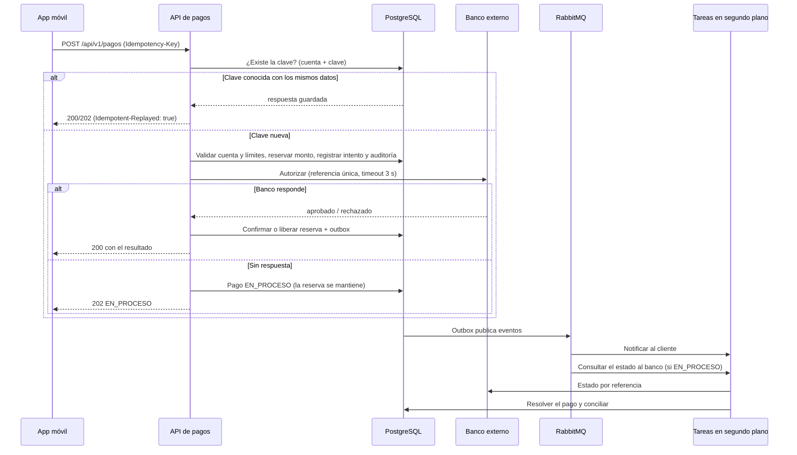

# Sistema de autorización de pagos

Una cooperativa recibe pagos desde su aplicación móvil. El sistema valida la cuenta, verifica los límites, llama al banco externo y **registra cada intento, incluso si el banco falla**. Después notifica al cliente y concilia con el banco.

**Demo interactiva:** `docs/index.html` (publicada con GitHub Pages) simula el flujo completo: pagos, reintentos con la misma clave, fallas del banco, tareas de segundo plano y conciliación.

## 1. Flujo de la solicitud a la conciliación



## 2. ¿Qué pasos deben ser síncronos?

Solo lo que el cliente necesita para recibir una respuesta correcta, y todo lo que protege el dinero:

1. Validar el formato de la solicitud y la clave de idempotencia.
2. Buscar la clave (cuenta + clave): si existe, devolver la respuesta guardada.
3. Validar que la cuenta exista, esté activa y tenga saldo disponible.
4. Verificar el límite por pago y el límite diario acumulado.
5. Reservar el monto y registrar el intento y la auditoría, **en una sola transacción**.
6. Llamar al banco con un tiempo máximo de espera.
7. Confirmar o liberar la reserva y responder.

## 3. ¿Qué tareas pueden procesarse en segundo plano?

| Tarea | Por qué no es síncrona |
|---|---|
| Notificación al cliente (SMS, push, correo) | El cliente ya recibió su respuesta; un fallo de notificación no debe afectar al pago |
| Consulta del estado al banco cuando no respondió | Puede tardar y requiere reintentos |
| Conciliación contra el banco | Compara muchos movimientos, no depende de una solicitud |
| Liberar reservas de pagos no confirmados | Es una corrección posterior |
| Reportes y métricas | No afectan la respuesta |

Se publican con el patrón **outbox**: el evento se guarda en la misma transacción que el cambio de estado y un publicador lo envía a RabbitMQ. Así no se pierde ningún evento si el servicio se cae justo después de confirmar.

## 4. ¿Cómo se evita cobrar dos veces?

- La app genera una **clave de idempotencia** (`Idempotency-Key`) por cada intención de pago y la reutiliza en los reintentos.
- La tabla `idempotencia` tiene clave primaria `(cuenta_id, clave)`. Aunque lleguen dos reintentos al mismo tiempo, la base de datos deja pasar solo uno; el otro recibe `409` o la respuesta guardada.
- Se guarda un **hash** de la solicitud (cuenta + monto + concepto):
  - misma clave y mismos datos devuelve la respuesta original sin cobrar otra vez (cabecera `Idempotent-Replayed: true`);
  - misma clave y datos distintos devuelve `422`, porque probablemente es un error del cliente.
- Al banco se le envía una **referencia única** por pago (`referencia_banco`, única en BD), para que el banco también pueda deduplicar si nuestro reintento interno repite la llamada.
- Las claves se conservan un tiempo definido (`IDEMPOTENCIA_TTL_HORAS`).

## 5. ¿Qué información debe quedar en la auditoría?

Cada intento deja un registro, aunque sea rechazado, repetido o falle un servicio externo:

- Identificador de correlación (para seguir una solicitud de punta a punta) y el pago asociado.
- Fecha y hora de cada evento: intento recibido, reintento deduplicado, conflicto de clave, validación fallida, reserva, llamada al banco, timeout, aprobación o rechazo, consulta al banco, notificación, conciliación.
- Clave de idempotencia, cuenta **enmascarada** (`****4821`), monto, moneda y canal.
- Resultado de cada regla (cuenta activa, saldo, límite por pago, límite diario) y el **motivo** del rechazo.
- Respuesta del banco (código y referencia) y latencia.
- Quién o qué ejecutó la acción (cliente, servicio, tarea de segundo plano).

No se guardan contraseñas, tokens ni números de cuenta completos. La tabla es de solo inserción: no se editan ni se borran registros.

## 6. ¿Qué pasa si el banco responde tarde o no responde?

La regla central: **no saber no es lo mismo que fallar**. Si el banco no respondió, quizás cobró.

1. **Timeout corto** (`BANCO_TIMEOUT_MS`, 3 s por defecto). Pasado ese tiempo no se espera más.
2. El pago pasa a **EN_PROCESO**, el monto **sigue reservado** y el cliente recibe `202`. No se declara el pago como fallido ni se vuelve a cobrar.
3. Una tarea en segundo plano **consulta el estado al banco por la referencia** (consulta segura, no vuelve a cobrar), con reintentos y espera creciente.
4. Con la respuesta del banco:
   - aprobado: se confirma el débito y se notifica;
   - rechazado: se libera la reserva y se notifica;
   - sin registro tras `BANCO_CONSULTAS_MAX` consultas: se libera la reserva con motivo `BANCO_SIN_CONFIRMACION`.
5. La **conciliación** corrige cualquier diferencia restante (por ejemplo, un cobro que el banco aplicó y aquí quedó en proceso).
6. **Circuit breaker:** tras varias fallas seguidas se deja de llamar al banco y se responde `503` de inmediato, **sin reservar monto**, para no acumular pagos en proceso ni colgar a los clientes.

## 7. Stack y justificación

| Tecnología | Decisión |
|---|---|
| Spring Boot 3 + Java 21 | API y tareas, monolito modular (pagos, cuentas y límites, idempotencia, integración con el banco, auditoría, conciliación, notificaciones) |
| PostgreSQL 16 | Transacciones, restricciones únicas para idempotencia, auditoría y outbox |
| REST + OpenAPI | Contrato en `api/openapi.yaml` |
| Docker / Compose | Entorno reproducible |
| **RabbitMQ: sí** | Notificaciones y conciliación son colas de trabajo con reintentos y cola de errores (DLQ). Es más simple de operar que Kafka |
| Kafka: no por ahora | Tendría sentido con volúmenes muy altos o si se necesitara reprocesar el historial de eventos como flujo continuo |
| Redis: no | No hay una necesidad de caché demostrada; la idempotencia debe vivir en la base de datos |

## 8. Métricas

| Métrica | Cómo se calcula |
|---|---|
| Latencia de autorización | `respuesta − recepción` de cada solicitud: media, p95 y p99 (Micrometer, `/actuator/prometheus`) |
| Pagos duplicados | Cobros con la misma cuenta y clave: **debe ser 0**. Se mide también cuántos reintentos se evitaron |
| Tasa de errores | Intentos con falla técnica (timeout, banco caído, 5xx) / total de intentos |
| Tiempo de conciliación | `conciliado_en − creado_en` por pago |

```sql
SELECT date_trunc('day', creado_en) AS dia,
       avg(conciliado_en - creado_en) AS tiempo_medio_conciliacion,
       count(*) FILTER (WHERE estado = 'EN_PROCESO') AS pendientes
FROM pago GROUP BY 1 ORDER BY 1;
```

## 9. Cómo ejecutar

```bash
docker compose up --build     # db + rabbitmq + backend
```

- Salud del backend: http://localhost:8080/actuator/health
- Interfaz de RabbitMQ: http://localhost:15672
- `.env` se versiona con valores de ejemplo. Las claves reales van en `.env.local` o `.env.production`, que están en `.gitignore`.
- El banco externo no está incluido en el compose: `BANCO_URL` apunta a un servicio simulado o real que debes proveer.

## 10. Estructura del repositorio

```
autorizacion-pagos/
├── .env                      Variables de entorno (valores de ejemplo)
├── .gitignore
├── Dockerfile                Imagen del backend (multi-stage, usuario no root)
├── docker-compose.yml        db + rabbitmq + backend
├── api/openapi.yaml          Contrato de la API
├── db/init.sql               Esquema y datos de ejemplo
├── backend/                  Esqueleto Spring Boot
└── docs/index.html           Simulador para GitHub Pages
```

## 11. Siguientes pasos

- Implementar en orden: idempotencia y pagos → límites → integración con el banco (timeout y breaker) → auditoría → outbox y RabbitMQ → conciliación.
- Añadir autenticación de la app móvil antes de exponer la API.
- Pruebas de concurrencia: dos solicitudes simultáneas con la misma clave deben producir un solo cobro.
